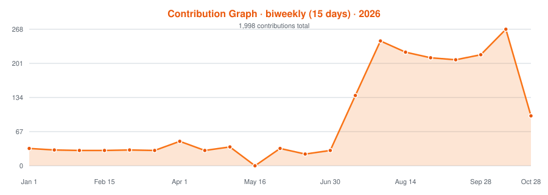
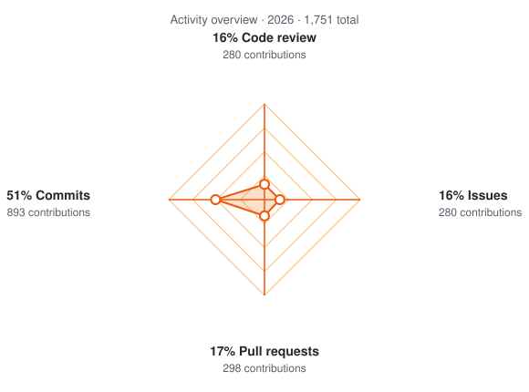

<!-- Profile README.md -->

 

---

### 👨🏾‍💻 About me

- **Head of Engineering & Product** at [Vittude](https://vittude.com/), leading the strategy for product and engineering areas.
- **Head of Technology** at [idwall](https://www.idwall.co), leading an area, aligning tech strategy, and boosting operational efficiency by over **77.41%**.
- **Engineering Tech Manager** at [PicPay](https://www.picpay.com), migrated to event-driven architecture and scaled the platform by **210%** with robust CI/CD pipelines on AWS.
- **University IT Professor** at [UNINASSAU](https://www.uninassau.edu.br), teaching Project Management, Software Engineering, and Systems Analysis.
- **Tech Lead & Software Engineer** at [CESAR](https://www.cesar.org.br/), and **Back-end Developer** at [Ogilvy](https://www.ogilvy.com/), building automation frameworks and scalable APIs in Java and Python.
- Passionate about **cloud-native architectures**, **microservices**, **EDA**, **data analytics** and mentoring high-performing teams.

 

### 🎮 Contribution Pac-Man

<picture>
  <source media="(prefers-color-scheme: dark)" srcset="https://raw.githubusercontent.com/livyson/livyson/d572e0e02b397339e9e74f4cdf3580e35f5bee86/pacman-contribution-graph-dark.svg">
  <source media="(prefers-color-scheme: light)" srcset="https://raw.githubusercontent.com/livyson/livyson/d572e0e02b397339e9e74f4cdf3580e35f5bee86/pacman-contribution-graph.svg">
  
</picture>

 

### 📊 GitHub Stats

 

 

### 🍕 Tech Distribution

 

### 🛠️ Tech Stack

 

 

### 🌐 Find me at

